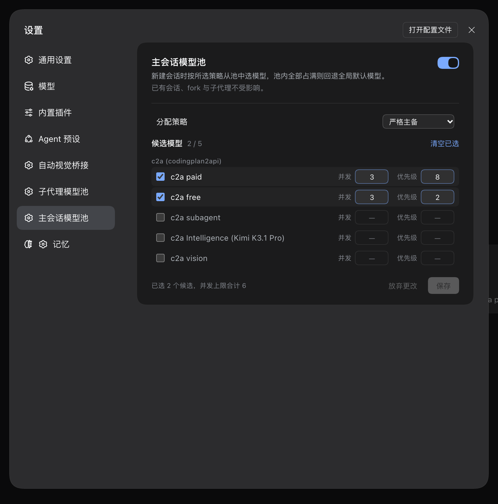
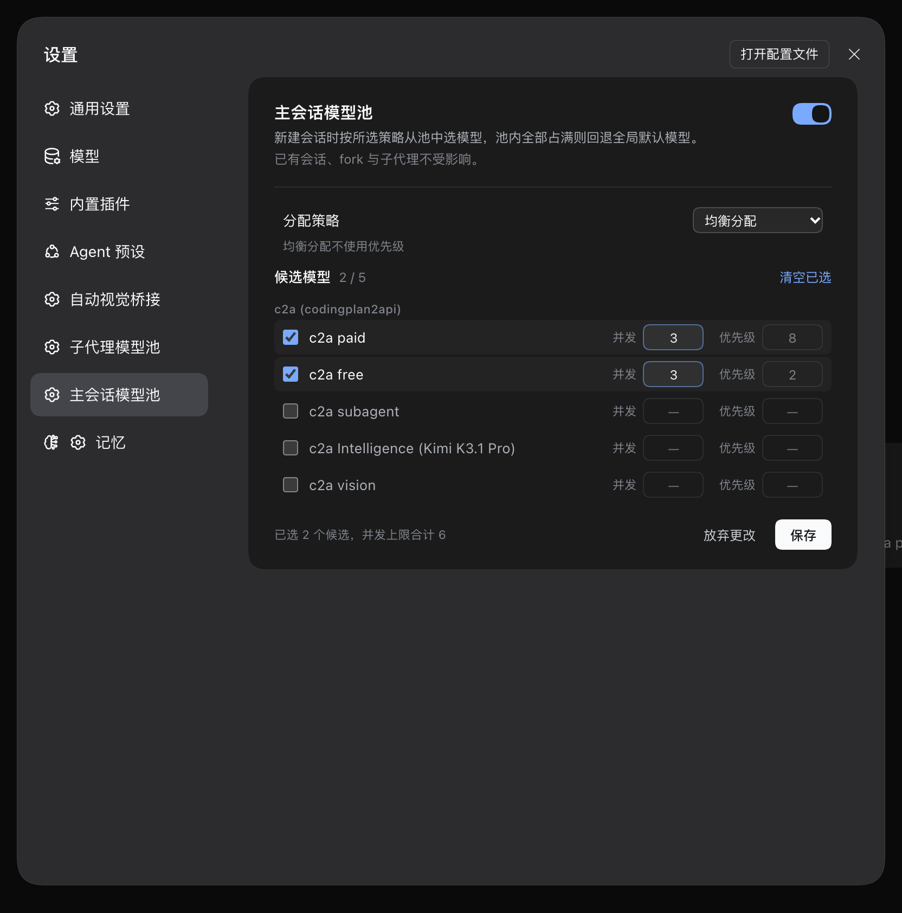

# dsh-main-model-pool

主会话模型池：新建会话时按「严格主备」或「均衡分配」从候选模型池里挑一个模型，每个候选独立设并发上限；池内全满就回退全局默认模型。

与 [dsh-subagent-model-pool](../dsh-subagent-model-pool) 的分工：那个管子代理，这个管**你亲手开的会话**。两者独立配置、独立计数，互不干涉。

## 行为语义

- **只在新建会话时选一次**。选中即锁定，会话中途不换模型——换一次就是全量重算前缀、KV 缓存全丢。
- **两种策略，可切换**（配置项 `strategy`）：
  - `strict-priority`（默认，严格主备）：按 `weight` 从大到小，高优先级候选没占满自己的 `maxConcurrent` 时绝不轮到低优先级。`weight` 相同按配置数组顺序。
  - `balanced`（均衡分配）：先剔除已占满的候选，再在剩下里挑累计指派次数（`assigned`）最少的；次数相同按配置数组顺序。首次派发全为 0 时落到第一个候选。`weight` 在该策略下不参与选择，但配置值保留。
- **并发按「轮正在跑」计**。分配瞬间乐观占位（防三个会话同时创建时都以为池是空的），`turn/start` 转为 running，`turn/end` 释放。
- **全满回退**：所有候选都占满时不改模型，链路落到设置里的全局默认模型（`agent-default-model`），且不计任何占用。
- **不探测候选**。不做真实请求探测，选中的候选如果不通，错误会在首轮请求时暴露，交给 DSH 自己的重试与错误链路。
- **不管三类**：子代理、fork 出来的会话、已经跑过轮次的会话（resume / 冷恢复）。

## 配置

```yaml
- id: main-model-pool
  name: dsh-main-model-pool
  config:
    enabled: true
    strategy: strict-priority   # 或 balanced
    pools:
      - provider: c2a
        model: paid
        maxConcurrent: 3
        weight: 8
      - provider: c2a
        model: free
        maxConcurrent: 3
        weight: 2
```

也可以在「设置 → 主会话模型池」里交互式勾选候选：候选来自 `llm` 的实时模型目录，按 provider 分组；勾选后单独设并发与优先级。页面顶部的「分配策略」下拉可切换两种策略；选均衡分配时「优先级」输入框置灰但值保留，切回严格主备即可继续编辑。切换策略会改变配置指纹，下次新建会话前自动换池，无需重启。

## 安装

插件必须同时进 profile 的三处，少一处会静默不挂载（服务照常启动、零报错）：

1. `~/.dsh/profiles/<profile>/package.json` 的 `dependencies` 里加 `"dsh-main-model-pool": "link:/path/to/dsh-main-model-pool"`；
2. 同一文件的 `dsh.profile.bundles` 数组里加 `"dsh-main-model-pool"`；
3. `~/.dsh/profiles/<profile>/cordis.patch.yml` 里加顶层条目覆盖 config（**必须带 `name`**，`configEditor.edit` 用 `id + name` 双条件匹配；漏了 `name` 保存时会追加重复条目）。

改完需要重启该 profile 的 DSH 进程才生效。

## 已知边界

- 没有抢占：已经在跑的轮次换不了模型；优先级/均衡顺序只影响创建时谁拿到名额。
- 没有硬排队：内核对会话并发没有上限也没有队列，想真的卡住只能在 `agent/created` 里 `await` 放行信号，那会让 `session/create` 的 RPC 一直 pending。本插件选择软限制 + 回退。
- 无统计视图（按需求只做配置）。

## 开发

```bash
/opt/homebrew/bin/node --test tests/*.test.js
```

端到端验证建议在隔离实例上做（不要重启生产进程）：

```bash
/opt/homebrew/bin/node ~/.local/bin/dsh web --port 3099 --no-open
```

## 设置页

「设置 → 主会话模型池」。严格主备与均衡分配两种状态：





选均衡分配时「优先级」输入框置灰，值保留不丢；切回严格主备即可继续编辑。

## 许可

MIT
